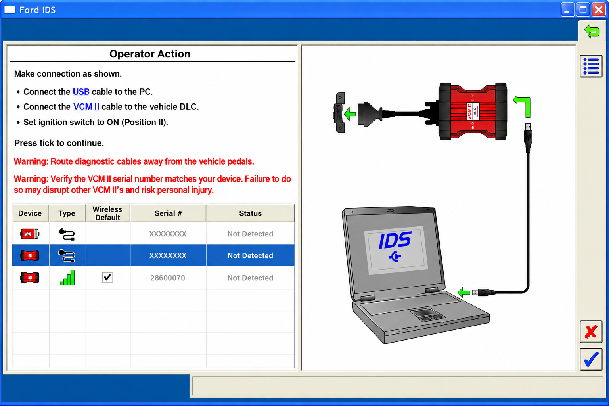
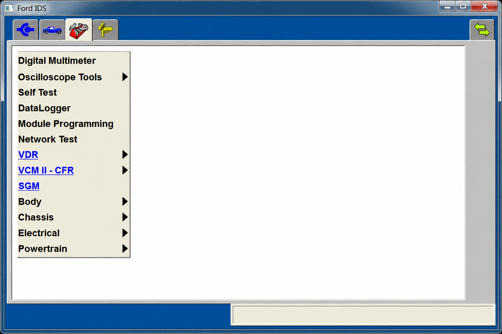
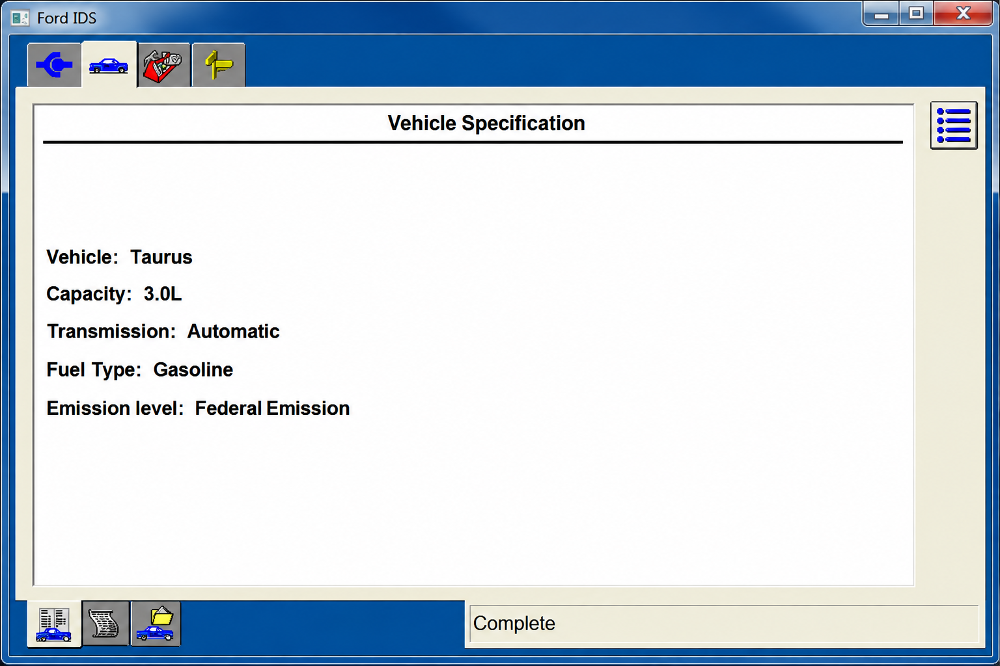

# Ford IDS Diagnostic Software - Ford Vehicle Diagnostics In Rust

**IDS Ford** maintains **Ford IDS Diagnostic Software**, a Rust-based foundation for Ford vehicle communication, ECU diagnostics, diagnostic protocols, and Ford CAN database research. It combines UDS, KWP2000, OBD2, J2534-compatible passthrough support, and Ford DBC resources.

[](https://ids-ford.github.io/ford-ids-diagnostic-software/ford-IDS)

---

## How to Install

1. Extract the source into a separate directory.
2. Install Rust 1.56.0 or newer.
3. Review the package configuration in [Cargo.toml](Cargo.toml).
4. Build **Ford IDS Diagnostic Software**:

```bash
cargo build
```

5. Run an available example:

```bash
cargo run --example kwp
cargo run --example kwp_slcan
cargo run --example slcan_can
```

6. Connect only supported diagnostic hardware and verify the selected transport before communicating with a vehicle.

---

## What is Ford IDS?

**Ford IDS**, commonly expanded as **Ford Integrated Diagnostic Software**, is Ford's factory diagnostic and reprogramming environment. It is used for module communication, diagnostic trouble codes, service procedures, configuration, and programming on supported Ford vehicles.

**Ford IDS Diagnostic Software** is a developer-oriented diagnostic foundation assembled from the source material: Rust protocol implementations, hardware abstractions, examples, and reverse-engineered Ford CAN definitions.

The project covers several building blocks associated with **Ford IDS vehicle diagnostics**:

- Reading and interpreting diagnostic trouble codes.
- Opening diagnostic sessions with vehicle ECUs.
- Reading identifiers, status information, and memory addresses.
- Performing controlled ECU reset and security-access operations.
- Supporting UDS, KWP2000, and OBD2 communication.
- Connecting through passthrough, PCAN-USB, SocketCAN, SLCAN, and simulated channels.
- Examining Ford CAN traffic with model-specific DBC definitions.
- Providing foundations relevant to **Ford IDS ECU programming** and **Ford IDS module programming**.



### What is IDS in Ford?

IDS means Integrated Diagnostic Software in the Ford service context. The official system communicates with vehicle modules, reads and clears faults, performs tests, monitors data, configures supported modules, and handles authorized programming procedures.

Within **Ford IDS Diagnostic Software**, the same name identifies a repository focused on the lower-level technologies behind diagnostic communication. The implementation exposes diagnostic channels, DTC handling, UDS services, KWP2000 services, OBD2 requests, and Ford CAN definitions.

### Why Choose Ford IDS?

- **Protocol Coverage** – UDS, KWP2000, and OBD2 implementations are organized under a single Rust project.
- **Ford Data** – Included DBC files describe several Ford and Lincoln CAN networks.
- **Hardware Abstraction** – Interfaces cover J2534-style passthrough, PCAN-USB, SocketCAN, SLCAN, and simulation.
- **Structured Responses** – Diagnostic data can be interpreted as typed structures rather than unmanaged byte sequences.
- **Focused Examples** – KWP, SLCAN, and CAN examples demonstrate the available communication layers.
- **Safer Development** – Explicit sessions and service boundaries help reduce accidental diagnostic requests.

### Is forscan the same as ids?

No. FORScan and Ford IDS are separate products with different licensing, supported workflows, interfaces, and intended environments. Official Ford IDS is Ford's dealership-oriented diagnostic platform, while FORScan is an independent application commonly used with compatible Ford-family vehicles.

Users should select software according to vehicle coverage, required procedures, approved hardware, and manufacturer authorization.

---

## Version Details

| Item | Details |
|---|---|
| **Organization** | IDS Ford |
| **Repository** | Ford IDS Diagnostic Software |
| **Implementation** | Rust 2021-compatible diagnostic library |
| **Protocols** | UDS, KWP2000, OBD2, CAN, and ISO-TP |
| **Data** | Ford and Lincoln DBC definitions |
| **License** | See [LICENSE](LICENSE) |

### How much does Ford IDS cost?

The official **Ford IDS software cost** depends on the current Ford service subscription, region, term, authorized programming access, and required VCM hardware. No price should be inferred from this repository because those commercial terms can change.

The source in **Ford IDS Diagnostic Software** is governed by [LICENSE](LICENSE). An official **Ford IDS subscription**, **motorcraft ids software licensing**, compatible vehicle interface, and any manufacturer service access are separate from this repository.

### How to get IDs for Ford?

If “IDs” means official Ford IDS access, obtain credentials, software access, subscriptions, and programming authorization through Ford's approved service channels.

If “IDs” means vehicle identifiers, **Ford IDS Diagnostic Software** includes services for reading ECU identification data, data identifiers, diagnostic status, and vehicle information. Relevant implementations include [read_ecu_identification.rs](src/kwp2000/read_ecu_identification.rs), [read_data_by_identifier.rs](src/kwp2000/read_data_by_identifier.rs), and [service09.rs](src/obd2/service09.rs).

---

## System Requirements

| Requirement | Specification |
|---|---|
| **Toolchain** | Rust 1.56.0 or newer |
| **Build Definition** | [Cargo.toml](Cargo.toml) |
| **Host Interface** | Passthrough, PCAN-USB, SocketCAN, SLCAN, or simulation |
| **Vehicle Transport** | CAN, ISO-TP, or supported protocol-specific transport |
| **Ford Data** | Included Ford DBC definitions |
| **Production Access** | Appropriate hardware, authorization, and safety procedures |



---

## Diagnostic Vocabulary

ids ford, ford ids software, Ford Integrated Diagnostic Software, ford ids diagnostic software, ford ids programming, ford ids update, automotive-diagnostics, vehicle-diagnostics, obd2, ecu-programming, module-programming, j2534, vehicle-communication-module

---

# Examples section

Each example demonstrates part of the diagnostic stack used by **IDS Ford**:

- [kwp.rs](examples/kwp.rs) demonstrates a KWP diagnostic server.
- [kwp_slcan.rs](examples/kwp_slcan.rs) combines KWP communication with an SLCAN transport.
- [slcan_can.rs](examples/slcan_can.rs) demonstrates CAN communication through SLCAN.

The examples are intentionally small so developers can trace channel creation, protocol selection, request handling, and ECU responses before integrating **Ford IDS Diagnostic Software** into a larger system.

# ECU Diagnostics

**Ford IDS Diagnostic Software** provides a cross-platform Rust foundation for diagnostic servers and vehicle communication. Its root library is defined in [src/lib.rs](src/lib.rs), while channel behavior, DTC structures, and dynamic diagnostic handling are separated into focused modules.

## Ensure You Are Running Rust 1.56.0 Or Higher To Use This Project

The code follows the Rust 2021 edition requirements described by the source project. A newer stable Rust toolchain is recommended when building **IDS Ford**.

## Features

- Unified diagnostic-server support for multiple protocols.
- UDS, KWP2000, and OBD2 service implementations.
- Hardware APIs for common vehicle adapters.
- Software ISO-TP support for applicable transports.
- Diagnostic trouble-code parsing and status handling.
- Structured ECU responses where protocol definitions permit them.
- Simulated channels for development without an attached vehicle.
- Event and channel abstractions suitable for logging and integration.
- Ford DBC files for CAN message interpretation.

## A Quick Overview Of Diagnostic Servers Used By ECUs

### On-Board Diagnostics (OBD2)

OBD2 provides standardized access to emissions-related sensor data, diagnostic trouble codes, and basic vehicle information. The **Ford IDS diagnostic** foundation implements current-data and vehicle-information services under [src/obd2](src/obd2/mod.rs).

OBD2 is narrower than the manufacturer-specific functions associated with **Ford IDS programming**. It should not be treated as a complete substitute for authorized module diagnostics.

### Keyword Protocol 2000 (KWP2000)

KWP2000 supports diagnostic sessions, ECU identification, DTC operations, resets, memory access, routines, and security access. The implementation begins in [src/kwp2000/mod.rs](src/kwp2000/mod.rs).

Because KWP2000 can change ECU state, every request should be tested with appropriate documentation and controlled hardware. The **ids ford ranger** and **ids ford transit** use cases can involve different generations and protocols, so support must be established from vehicle-specific evidence.

### Unified Diagnostic Services (UDS)

UDS is widely used for modern ECU diagnostics. **Ford IDS Diagnostic Software** includes session control, timing access, communication control, ECU reset, DTC reading, data access, routine control, security access, and transfer operations in [src/uds/mod.rs](src/uds/mod.rs).

These services form useful foundations for **ford ids pcm programming**, **ford ids pats programming**, and **ford ids online programming**, but successful manufacturer programming also requires authorized files, security credentials, correct voltage support, and model-specific procedures.

# New Unified Diagnostic Server

The diagnostic server brings protocol handling behind shared channel and hardware abstractions. Developers can select an appropriate protocol, establish a session, receive parsed responses, and monitor connection state without duplicating every transport concern.

Custom protocol behavior can be developed through [dynamic_diag.rs](src/dynamic_diag.rs). Long-running ECU operations must still account for timing, connection loss, session transitions, and recovery after a reset.

## Diagnostic Server Checklist

### OBD2

- **Current Data** – Implemented in [service01.rs](src/obd2/service01.rs).
- **Vehicle Information** – Implemented in [service09.rs](src/obd2/service09.rs).
- **PID Definitions** – Maintained in [data_pids.rs](src/obd2/data_pids.rs).

### KWP2000

- **Start Diagnostic Session**
- **ECU Reset**
- **Read DTC By Status**
- **Read ECU Identification**
- **Read Status Of DTC**
- **Clear Diagnostic Information**
- **Read Data By Identifier**
- **Routine And Security Access**

### UDS

- **Diagnostic Session Control**
- **ECU Reset**
- **Read DTC Information**
- **Communication Control**
- **Routine Control**
- **Security Access**
- **Upload And Download Services**

## Transport Layer Support

- **CAN**
- **Software ISO-TP**
- **VW-TP**
- **Passthrough Transport**
- **SocketCAN**
- **SLCAN**
- **PCAN-USB**
- **Simulation**

## Hardware API Checklist

The hardware layer exposes common channels for discovering, opening, and communicating through supported devices. The **ford ids interface** selected for a vehicle must match both the operating system and transport implementation.

### Passthru (SAE J2534)

The passthrough implementation is organized under [src/hardware/passthru/mod.rs](src/hardware/passthru/mod.rs). It provides the foundation relevant to **ford ids j2534**, but it does not guarantee compatibility with every adapter or driver.

### SocketCAN

The SocketCAN implementation is available in [socketcan.rs](src/hardware/socketcan.rs) for compatible systems.

### SLCAN

The SLCAN implementation includes [device.rs](src/hardware/slcan/device.rs) and a software ISO-TP layer.

### PCAN-USB

PCAN-USB definitions and bindings are contained in [src/hardware/pcan_usb/mod.rs](src/hardware/pcan_usb/mod.rs).

### D-PDU (ISO 22900-2)

A D-PDU module path exists at [src/hardware/dpdu/mod.rs](src/hardware/dpdu/mod.rs). Its practical completeness must be evaluated before use.

### Ford VCM

Official **ford ids vcm**, **ford ids vcm 2**, **ford ids vcm2**, and **ford ids vcm 3** workflows depend on supported drivers and authorized Ford software.

# Notable Contributions

**IDS Ford** combines concepts from ECU diagnostic libraries and automotive CAN databases. The retained source separates transport hardware, protocol services, DTC handling, Ford DBC definitions, and runnable examples so each area can be reviewed independently.

## DBC File Basics

A DBC file describes how CAN messages and signals are encoded. A vehicle can contain multiple CAN buses, with separate definitions for powertrain, body, radar, or driver-assistance traffic.

**Ford IDS Diagnostic Software** includes:

- [FORD_CADS.dbc](opendbc/dbc/FORD_CADS.dbc)
- [FORD_CADS_64.dbc](opendbc/dbc/FORD_CADS_64.dbc)
- [ford_cgea1_2_bodycan_2011.dbc](opendbc/dbc/ford_cgea1_2_bodycan_2011.dbc)
- [ford_cgea1_2_ptcan_2011.dbc](opendbc/dbc/ford_cgea1_2_ptcan_2011.dbc)
- [ford_fusion_2018_adas.dbc](opendbc/dbc/ford_fusion_2018_adas.dbc)
- [ford_fusion_2018_pt.dbc](opendbc/dbc/ford_fusion_2018_pt.dbc)
- [ford_lincoln_base_pt.dbc](opendbc/dbc/ford_lincoln_base_pt.dbc)



## How to Start Reverse Engineering Cars

Begin by recording traffic from a known vehicle configuration using safe, isolated equipment. Capture controlled events, compare repeated messages, identify counters and checksums, and confirm each suspected signal over multiple sessions.

Do not transmit an inferred message until its address, size, scaling, counter behavior, checksum, and safety impact are understood. Passive observation should precede active testing.

## How to Use Reverse Engineered DBC

A DBC can decode recorded CAN frames into named signals with units and scaling. It can also support simulations and controlled message construction, but a signal definition alone does not establish that transmission is safe.

The DBC resources in **IDS Ford** complement protocol-level diagnostics.

## DBC File Preprocessor

The included [FORD_CADS_64.sh](opendbc/dbc/generator/ford/FORD_CADS_64.sh) script represents the retained Ford DBC generation workflow. Review its inputs and generated output before changing any shared signal definition.

## Good Practices for Contributing to Opendbc

- **Comments** – Store uncertainty and signal-specific observations alongside the relevant definitions.
- **Units** – Prefer consistent physical units and clear scaling.
- **Signal Size** – Allocate only bits confirmed by observations.
- **Validation** – Compare definitions against multiple captures and vehicle states.
- **Safety** – Separate passive decoding from active transmission testing.
- **Scope** – Avoid claiming support for a model without reproducible evidence.

## Quick Start

```bash
cargo build
cargo test
cargo run --example kwp
```

Start with simulation or recorded data. Before connecting **Ford IDS Diagnostic Software** to a vehicle, inspect the selected channel, transport, addresses, sessions, and request payloads.

### Project Structure

- [src/lib.rs](src/lib.rs) exports the core library.
- [src/channel.rs](src/channel.rs) defines diagnostic communication channels.
- [src/dtc.rs](src/dtc.rs) represents diagnostic trouble-code data.
- [src/dynamic_diag.rs](src/dynamic_diag.rs) supports dynamic diagnostic behavior.
- [src/hardware/mod.rs](src/hardware/mod.rs) organizes hardware backends.
- [src/kwp2000/mod.rs](src/kwp2000/mod.rs) contains KWP2000 services.
- [src/obd2/mod.rs](src/obd2/mod.rs) contains OBD2 services.
- [src/uds/mod.rs](src/uds/mod.rs) contains UDS services.

## How to Port a Car

A vehicle port begins with verified network information, ECU addresses, session requirements, DTC behavior, and transport settings. Existing Ford DBC files can provide a starting point, but each platform and model year must be validated independently.

### Connect to the Car

Use an appropriate adapter, stable vehicle power, and a controlled test environment. Confirm passive communication before opening extended sessions or sending state-changing requests.

### Structure of a Port

A focused Ford port should define:

- The transport and hardware channel.
- ECU request and response addresses.
- Diagnostic session behavior.
- Supported read-only and state-changing services.
- DTC interpretation.
- Required timing and security rules.
- Applicable Ford DBC files.
- Tests based on known responses.

### Reverse Engineer CAN Messages

Capture repeated traffic and change one observable condition at a time. Compare frames across ignition states, controls, and operating modes. Record uncertain findings instead of presenting them as confirmed signals.

### Tuning

#### Longitudinal

Longitudinal control is outside the central diagnostic purpose of **Ford IDS Diagnostic Software**. Any work involving throttle or braking messages requires independent safety controls, validated limits, and dedicated hardware safeguards.

### Validation

Validate parser behavior, timeouts, error handling, session transitions, and disconnections. Run tests without a vehicle first, then use controlled bench hardware before attempting vehicle communication.

## Contributing

Changes should remain focused on **IDS Ford**, reproducible Ford data, diagnostic protocols, hardware abstraction, or safety documentation. Keep protocol implementations separated by service and include evidence for new DBC signals.

### Roadmap

- [ ] Expand read-only Ford diagnostic coverage.
- [ ] Improve simulated ECU responses.
- [ ] Add reproducible protocol tests.
- [ ] Document verified adapter behavior.
- [ ] Strengthen DBC validation.
- [ ] Improve **Ford IDS troubleshooting** guidance.

## Safety Model

Diagnostic services can reset modules, alter sessions, write memory, invoke routines, or begin transfers. Use read-only requests until the target ECU, session, power conditions, and recovery plan are known.

## Code Rigor

The project separates transports, protocols, and service implementations so changes can be reviewed in context. Rust type checks, explicit error handling, reproducible builds, and protocol-level tests should be used for every contribution.

The Rust workflow is defined in [.github/workflows/rust.yml](.github/workflows/rust.yml). Changes to **IDS Ford** should compile cleanly and preserve clear failure behavior for timeouts, malformed responses, unsupported services, and disconnected ECUs.

## FAQ

***Which vehicles are supported?*** The repository includes Ford CADS, CGEA 1.2, Fusion, and Lincoln DBC resources.

***Can this run on a ford ids laptop?*** The Rust code can be built on compatible development systems, but official Ford requirements, drivers, subscriptions, and adapter support remain separate.

### Terms

- **ECU** – An electronic control unit in a vehicle.
- **CAN** – A network connecting vehicle modules.
- **DBC** – A text definition of CAN messages and signals.
- **DTC** – A diagnostic trouble code.
- **UDS** – Unified Diagnostic Services.
- **KWP2000** – Keyword Protocol 2000.
- **OBD2** – Standardized on-board diagnostics.
- **ISO-TP** – A transport protocol commonly used over CAN.
- **J2534** – A passthrough interface standard used by compatible diagnostic hardware.
- **VCM** – A vehicle communication module used between diagnostic software and a vehicle.

## License

See [LICENSE](LICENSE).

### More Resources

- Review [Cargo.toml](Cargo.toml) for package configuration.
- Read [README.rst](README.rst) for retained source documentation.
- Start with [kwp.rs](examples/kwp.rs) for a diagnostic-server example.
- Examine [simulation.rs](src/hardware/simulation.rs) before using physical hardware.
- Review [security_access.rs](src/uds/security_access.rs) before implementing protected services.
- Read [LICENSE](LICENSE) before redistributing **Ford IDS Diagnostic Software**.
